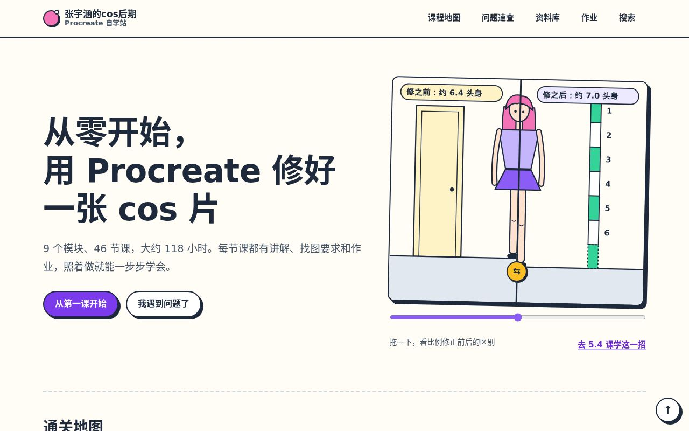
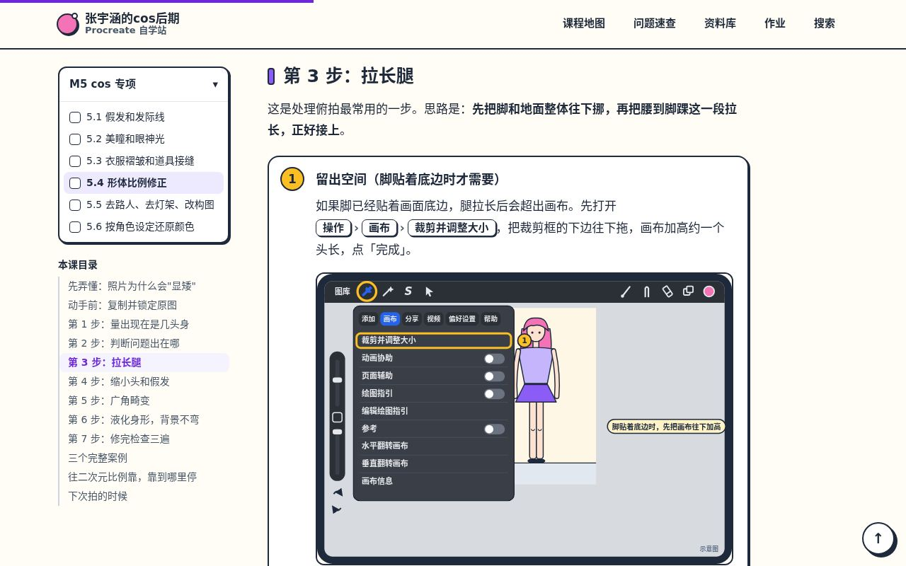
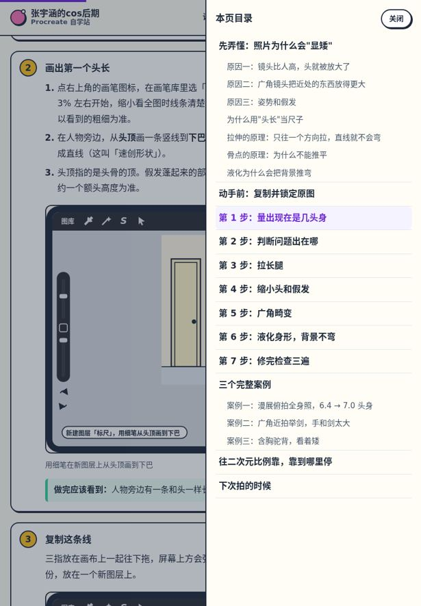

# 张宇涵的cos后期Procreate 自学站

用 iPad + Procreate 从零学 cosplay 照片后期。9 个模块、46 节课，从认识一张照片讲到精修、特效、合成和接单交付。每节课都有原理讲解、带界面示意图的分步操作、完整案例、找图要求和作业。

**在线阅读：<https://cos.llmunify.com>**

A free, open Chinese course on retouching cosplay photos with Procreate on iPad: 46 lessons with step-by-step illustrated instructions, worked examples and homework. Built as a static site; content under CC BY-NC-SA 4.0, code under MIT.



## 课程有什么

| 模块 | 内容 | 课数 |
|---|---|---|
| M0 开课准备 | 设备和软件、认识一张数码照片、后期流程和协作规范 | 3 |
| M1 Procreate 基础操作 | 界面、手势、画笔、图层和混合模式、蒙版、选区和变换 | 6 |
| M2 Procreate 修图工具 | 调整菜单、克隆、液化、模糊锐化杂色、抠图、不破坏原图的习惯 | 6 |
| M3 视觉基础理论 | 光影、色彩、人像肤色、比例、骨点、透视和镜头畸变、构图 | 7 |
| M4 人像基础修图 | 四步诊断、曝光和白平衡、皮肤、光影重塑、五官和妆面 | 5 |
| M5 cos 专项 | 假发和发际线、美瞳、衣服褶皱、形体比例、去路人、按设定还原颜色 | 6 |
| M6 特效和氛围 | 泛光和色像差、光效、手绘光效、粒子飘落、环境光 | 5 |
| M7 合成 | 换背景、合成五要素、漫展场照半合成、完整合成 | 4 |
| M8 风格和作品集 | 复刻练习、个人风格和预设、作品集、接单交付 | 4 |

另外还有：20 个常见问题的速查页、200 多条学习资料、PS 和 Procreate 功能对照表、各模块阶段作业和毕业作品评分表。

| 课程页 | iPad 竖屏的本页目录 |
|---|---|
|  |  |

几点说明：

- 网站**不提供练习照片**，每个作业都写了需要什么样的照片，用你自己的返图练习。
- 界面图是用代码画的**示意图**，不是软件截图。按钮位置以你设备上的实际界面为准。
- 学习进度保存在浏览器里，不用注册。在 iPad 上建议「添加到主屏幕」后使用。

## 本地预览

需要 Python 3.9 以上。

```bash
git clone https://github.com/wzyaooh/cos-procreate-course.git
cd cos-procreate-course
pip install -r requirements.txt
python tools/build.py --out preview --preview
```

然后用浏览器打开 `preview/index.html`。预览版用相对路径，双击就能打开，不需要启动服务器。

## 部署

用 Docker 部署，一个容器，里面跑 Caddy。两种方式：

- **反代模式**（默认）：服务器上已经有 nginx、1Panel、宝塔等占着 80/443，由它们转发到容器的 `127.0.0.1:8080`，证书也由它们管。
- **直连模式**：服务器上只有这一个网站，Caddy 直接对外，自动申请和续期 HTTPS 证书。

```bash
git clone https://github.com/wzyaooh/cos-procreate-course.git
cd cos-procreate-course
cp .env.example .env      # 把 SITE_DOMAIN 改成你的域名
docker compose up -d --build
bash tools/deploy_check.sh
```

域名解析、1Panel / nginx 反代配置、常见问题见 **[docs/deploy.md](docs/deploy.md)**。

## 参与改进

课程按 Procreate 官方中文手册编写，但软件会更新，难免有对不上的地方。欢迎：

- **报告问题**：某一步和你的 iPad 对不上、数字有问题、链接失效 → [提交 Issue](https://github.com/wzyaooh/cos-procreate-course/issues/new/choose)，写清楚哪一课哪一步、你的 Procreate 版本。
- **直接修改**：课程都是 Markdown 文件，在 `content/` 里。写法、检查命令见 **[CONTRIBUTING.md](CONTRIBUTING.md)** 和 **[docs/authoring.md](docs/authoring.md)**。

## 许可

- **课程内容**（`content/`、`static/diagrams/`、`static/icons/`）：[CC BY-NC-SA 4.0](LICENSE-CONTENT)。可以转载和改编，要署名、不能商用、改编后用同样的协议发布。
- **代码**（构建脚本、模板、样式、脚本、部署配置）：[MIT](LICENSE)。
- 资料库里链接到的视频和文章版权归原作者所有。本项目与 Procreate、Adobe 等公司无关，详见 [NOTICE.md](NOTICE.md)。

作者：不吃香菜的猴子
